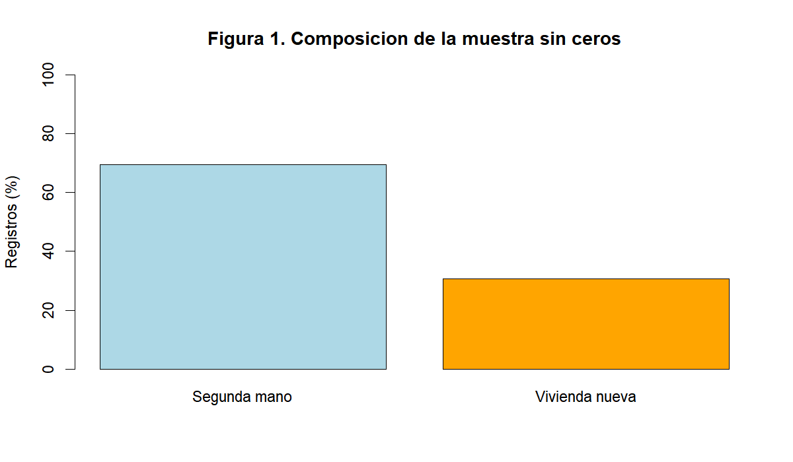
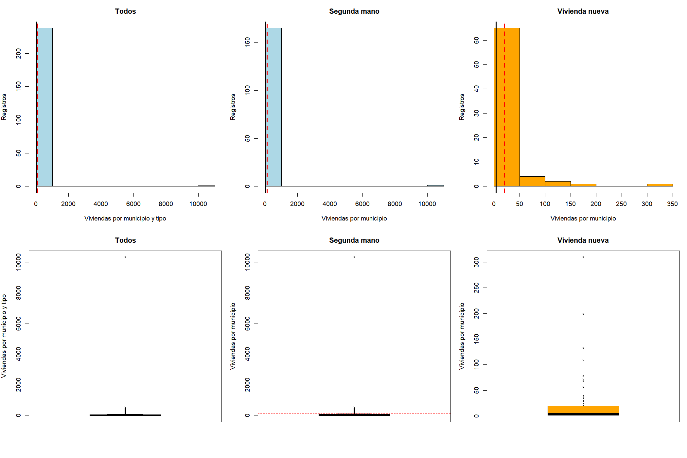
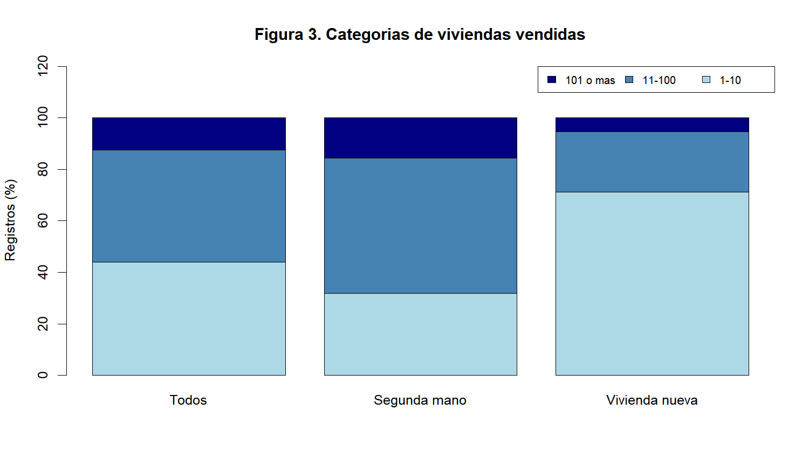

# Análisis de las viviendas vendidas por municipio en la Comunidad de Madrid durante el cuarto trimestre de 2025

**Autor:** Hugo Abellán Lopez  
**Asignatura:** Estadística · Práctica de laboratorio PL1  
**Fecha:** 24 de octubre de 2026

Comparación entre vivienda nueva y de segunda mano. Informe en Markdown publicado en GitHub como actividad extra de PL1.

## 1. Introducción

### 1.1 Contexto

El número de viviendas vendidas permite describir el volumen de actividad inmobiliaria de los municipios. La vivienda nueva y la de segunda mano pueden presentar distribuciones distintas. Se estudian las ventas por municipio de la Comunidad de Madrid en el **cuarto trimestre de 2025 (octubre-diciembre)**.

### 1.2 Objetivo

Realizar un análisis estadístico descriptivo del número de viviendas vendidas en un municipio durante el cuarto trimestre de 2025, comprobando las diferencias entre vivienda nueva y de segunda mano.

### 1.3 Alcance

El estudio se limita al archivo facilitado para 2025-T4. **Antes de realizar cualquier cálculo se eliminan todas las filas con Valor=0**, siguiendo la indicación del profesor. Se analizan 239 registros positivos: 166 de segunda mano y 73 de vivienda nueva. No se estudian precios ni cambios temporales.

## 2. Metodología

### 2.1 Origen de los datos

Se utiliza `transacciones_vivienda_municipios_2025_T4.csv`, selección facilitada para la práctica. El conjunto oficial es [Transacciones inmobiliarias de vivienda nueva y de segunda mano, por municipio. Comunidad de Madrid](https://datos.comunidad.madrid/dataset/transacciones_vivienda_nueva_usada_municipio). Esa página permite descargar los datos originales y señala como fuente la Estadística de Transacciones Inmobiliarias. El catálogo puede actualizarse; los cálculos reproducen el archivo incluido en el proyecto de RStudio que se entrega con la práctica.

### 2.2 Herramientas

Se utiliza R 4.6.1 con funciones de R base, sin instalar paquetes. El proyecto puede abrirse en RStudio. Se ha empleado asistencia de inteligencia artificial para preparar el código, posteriormente ejecutado y comprobado. El código se entrega en `analisis.R`, separado del informe. Sigue los procedimientos de las prácticas 1, 2 y 3: lectura y filtros, medidas descriptivas y comparación por grupos con `tapply`.

### 2.3 Diseño

- **Variable cuantitativa:** número de viviendas de un tipo determinado que se han vendido en un municipio de la Comunidad de Madrid durante el cuarto trimestre de 2025. Es discreta y su unidad es viviendas vendidas por municipio en ese trimestre y para ese tipo.
- **Variable cualitativa:** tipo de vivienda, con categorías Segunda mano y Vivienda nueva.
- **Población de referencia:** registros municipio-tipo de la Comunidad de Madrid en 2025-T4. El archivo original contiene 358 registros de 179 municipios y dos tipos. Cada individuo representa un municipio para un tipo de vivienda en ese periodo, no una vivienda individual.
- **Muestra analizada:** 239 registros positivos, seleccionados por el criterio indicado; no es una muestra aleatoria.
- **Organización:** eliminación de 119 ceros, separación por Tipo y creación de intervalos de ventas para tablas y diagramas. No se eliminan los valores extremos positivos.

Un municipio puede aparecer en ambos grupos. Al eliminar ceros se conservan conjuntos municipales diferentes. La columna **Todos** reúne registros municipio-tipo; no representa el total de ventas agregado por municipio.

## 3. Resultados

### 3.1 Muestras

La tabla 1 resume la limpieza. Ambos grupos conservan más de 30 datos. Las muestras ordenadas aparecen en el anexo A. El tamaño de muestra es el número de registros, no la suma de viviendas.

**Tabla 1. Número de registros antes y después de eliminar Valor=0.**

| Tipo | Originales | Eliminados | Analizados |
|---|---:|---:|---:|
| Segunda mano | 179 | 13 | 166 |
| Vivienda nueva | 179 | 106 | 73 |
| Total | 358 | 119 | 239 |

### 3.2 Medidas estadísticas

La tabla 2 presenta centralización, dispersión, localización y forma para Todos y los dos grupos.

**Tabla 2. Medidas descriptivas de viviendas vendidas por municipio en 2025-T4.**

| Medida | Todos | Segunda mano | Vivienda nueva |
|---|---:|---:|---:|
| Tamaño (registros) | 239 | 166 | 73 |
| Suma (viviendas) | 21188 | 19677 | 1511 |
| Media (v) | 88,65 | 118,54 | 20,70 |
| Mediana (v) | 13,00 | 21,50 | 4,00 |
| Moda (v) | 1,00 | 3,00 | 1,00 |
| Mínimo (v) | 1,00 | 1,00 | 1,00 |
| Máximo (v) | 10.344,00 | 10.344,00 | 310,00 |
| Rango (v) | 10.343,00 | 10.343,00 | 309,00 |
| Varianza muestral (v²) | 451.076,82 | 646.712,35 | 2.269,55 |
| Desviación típica (v) | 671,62 | 804,18 | 47,64 |
| Coeficiente de variación | 7,58 | 6,78 | 2,30 |
| Primer cuartil (v) | 4,00 | 7,00 | 1,00 |
| Tercer cuartil (v) | 38,00 | 55,00 | 19,00 |
| Rango intercuartílico (v) | 34,00 | 48,00 | 18,00 |
| Asimetría | 14,90 | 12,39 | 4,08 |
| Exceso de curtosis | 224,46 | 154,47 | 18,99 |
| Inferiores a la media | 207 (86,61%) | 143 (86,14%) | 55 (75,34%) |
| Superiores a la media | 32 (13,39%) | 23 (13,86%) | 18 (24,66%) |

**Unidades:** v = viviendas vendidas por municipio en el cuarto trimestre de 2025 para el tipo correspondiente. La varianza tiene esa unidad al cuadrado. CV, asimetría y curtosis no tienen unidades. No hay valores iguales a la media.

La varianza y la desviación típica usan n-1. Los cuartiles y el rango intercuartílico se calculan con **tipo 2**, siguiendo la práctica 2. Para las medidas de forma se usan las funciones definidas en esa práctica: asimetría = media de (x - media)^3 / s^3; exceso de curtosis = media de (x - media)^4 / s^4 - 3, donde s es la desviación típica muestral. Son equivalentes al tipo 3 de `e1071`, sin necesidad de instalar ese paquete. Todos los cálculos se realizan sobre los valores originales.

### 3.3 Tablas de contingencia

La tabla 3 utiliza cinco intervalos y la tabla 4 resume tres categorías descriptivas, que no son categorías oficiales. Los extremos de los intervalos son inclusivos porque los valores son enteros. f cuenta registros y h es la frecuencia relativa respecto a los 239 registros.

**Tabla 3. Contingencia con cinco intervalos de viviendas vendidas.**

| Ventas por municipio | Segunda mano | Vivienda nueva | f | h |
|---|---:|---:|---:|---:|
| 1-10 | 53 | 52 | 105 | 0,44 |
| 11-50 | 70 | 13 | 83 | 0,35 |
| 51-100 | 17 | 4 | 21 | 0,09 |
| 101-500 | 24 | 4 | 28 | 0,12 |
| 501 o mas | 2 | 0 | 2 | 0,01 |
| f por tipo | 166 | 73 | 239 | |
| h por tipo | 0,69 | 0,31 | | 1,00 |

**Tabla 4. Contingencia con tres categorías de viviendas vendidas.**

| Ventas por municipio | Segunda mano | Vivienda nueva | f | h |
|---|---:|---:|---:|---:|
| 1-10 | 53 | 52 | 105 | 0,44 |
| 11-100 | 87 | 17 | 104 | 0,44 |
| 101 o mas | 26 | 4 | 30 | 0,13 |
| f por tipo | 166 | 73 | 239 | |
| h por tipo | 0,69 | 0,31 | | 1,00 |

Las frecuencias relativas se redondean a dos decimales; su suma mostrada puede diferir ligeramente de uno.

### 3.4 Diagramas

La figura 1 muestra el peso de cada tipo entre los registros positivos.



**Figura 1. Porcentaje de registros por tipo de vivienda, sin ceros.**

La figura 2 muestra histogramas y diagramas de caja para Todos y cada tipo.



**Figura 2. Histogramas y diagramas de caja de las ventas, total y por tipo.**

Los histogramas y diagramas de caja muestran el número original de viviendas vendidas, sin aplicar logaritmos. Cada panel tiene su propia escala; deben leerse sus ejes antes de comparar. La línea negra indica la mediana y la roja discontinua la media. El máximo de segunda mano comprime visualmente los valores pequeños; la tabla 2 y la figura 3 permiten completar la comparación. Los diagramas de caja usan las bisagras de Tukey que aplica `boxplot` de R, que pueden diferir ligeramente de los cuartiles de tipo 2 de la tabla. Los puntos fuera de los bigotes son atípicos según la regla del diagrama, pero se mantienen en todos los cálculos.

La figura 3 compara los porcentajes de las categorías de la tabla 4 dentro de cada muestra.



**Figura 3. Porcentajes por categoría de ventas en Todos y en cada tipo.**

Fuente de todas las tablas y figuras: elaboración propia a partir del archivo facilitado, tras eliminar Valor=0. Periodo: cuarto trimestre de 2025.

## 4. Análisis de resultados

La tabla 1 y la figura 1 muestran que el 69,46% de los 239 registros positivos corresponde a segunda mano (166 registros) y el 30,54% a vivienda nueva (73 registros). Se eliminaron 106 registros de vivienda nueva y 13 registros de segunda mano; esto condiciona los tamaños de los grupos.

Según la tabla 2, Todos tiene una media de 88,65 viviendas vendidas por municipio y tipo en 2025-T4 y una mediana de 13,00 viviendas vendidas por municipio y tipo en ese trimestre. La media de segunda mano es de 118,54 viviendas vendidas por municipio, frente a 20,70 viviendas nuevas vendidas por municipio, siempre en el cuarto trimestre de 2025. Las medianas respectivas son 21,50 y 4,00 viviendas vendidas por municipio en dicho trimestre. La segunda mano presenta valores mayores con ambas medidas.

La tabla 2 y la figura 2 reflejan gran dispersión. La desviación típica es de 804,18 viviendas de segunda mano vendidas por municipio en 2025-T4, frente a 47,64 viviendas nuevas vendidas por municipio en ese trimestre. Los CV son 6,78 y 2,30: la segunda mano también tiene mayor dispersión relativa. Sus cuartiles van de 7,00 a 55,00 viviendas de segunda mano vendidas por municipio en 2025-T4; en vivienda nueva van de 1,00 a 19,00 viviendas nuevas vendidas por municipio en ese trimestre.

La asimetría es positiva en Todos (14,90), segunda mano (12,39) y vivienda nueva (4,08), como indica la tabla 2. La figura 2 muestra valores altos aislados. El máximo es de 10.344 viviendas de segunda mano vendidas en un municipio en 2025-T4, frente a 310 viviendas nuevas vendidas en un municipio en ese trimestre. El exceso de curtosis es elevado: 224,46 en Todos, 154,47 en segunda mano y 18,99 en vivienda nueva. Refleja el peso de los extremos; los histogramas se representan en la escala original y muestran la concentración de las ventas en los intervalos bajos.

La tabla 2 muestra que 143 registros de segunda mano (86,14%) y 55 de vivienda nueva (75,34%) quedan por debajo de la media de su grupo. La mediana permite describir el centro con menor influencia de los municipios con más ventas.

La tabla 3 indica que solo 2 registros de segunda mano superan las 500 viviendas vendidas por municipio en 2025-T4; ninguno de vivienda nueva supera ese umbral. La tabla 4 y la figura 3 muestran que la categoría de 1 a 10 viviendas vendidas por municipio en dicho trimestre reúne el 71,23% de los registros de vivienda nueva, el 31,93% de segunda mano y el 43,93% de Todos. La vivienda nueva positiva se concentra en recuentos pequeños.

Estas diferencias son descriptivas. No se ajusta por población ni por parque de viviendas y no se establecen causas. La eliminación de ceros deja conjuntos municipales diferentes. Todos mezcla los dos tipos y no representa el total de ventas agregado de cada municipio.

## 5. Conclusiones

Entre los registros positivos de la Comunidad de Madrid, la segunda mano presenta más viviendas vendidas por municipio en el cuarto trimestre de 2025, tanto según la media como según la mediana. También tiene mayor variabilidad absoluta y relativa. Ambas distribuciones tienen cola hacia ventas altas y valores extremos; la mediana resulta menos sensible a ellos. Las conclusiones se limitan al periodo estudiado y a los registros conservados después de eliminar Valor=0.

## 6. Referencias

- Comunidad de Madrid. (s. f.). *Transacciones inmobiliarias de vivienda nueva y de segunda mano, por municipio. Comunidad de Madrid* [Conjunto de datos]. [Catálogo y descarga](https://datos.comunidad.madrid/dataset/transacciones_vivienda_nueva_usada_municipio). Consulta: 24 de octubre de 2026.
- Hilera, J. R. (2026). [Práctica 1: Introducción a R y RStudio](https://hilera.web.uah.es/estadistica/r/p1/index.html).
- Hilera, J. R. (2026). [Práctica 2: Estadística descriptiva con una variable](https://hilera.web.uah.es/estadistica/r/p2/p2.pdf).
- Hilera, J. R. (2026). [Práctica 3: Estadística descriptiva con dos variables](https://hilera.web.uah.es/estadistica/r/p3/p3.pdf).
- Hilera, J. R. (2026). *Práctica 4: Informe de estadística descriptiva* [Material docente, p4.pdf]. CC-BY.
- Universidad de Alcalá. (s. f.). *PL1: Informe de estadística descriptiva* [Enunciado facilitado, PL1.pdf].

## Anexo A. Muestras ordenadas

Valores en viviendas vendidas por municipio en el cuarto trimestre de 2025 para el tipo correspondiente. Todos reúne registros municipio-tipo. Se conservan las repeticiones y se excluyen los ceros.

### Todos (239 registros)

```text
    1     1     1     1     1     1     1     1     1     1     1     1
    1     1     1     1     1     1     1     1     1     1     1     1
    1     1     1     1     2     2     2     2     2     2     2     2
    2     2     2     2     2     2     2     3     3     3     3     3
    3     3     3     3     3     3     3     3     3     3     3     4
    4     4     4     4     4     4     4     4     5     5     5     5
    5     5     5     6     6     6     6     6     6     6     6     6
    6     6     7     7     7     7     7     7     7     7     7     7
    8     8     8     8     8     9    10    10    10    11    11    11
   11    11    11    12    12    12    12    12    13    13    13    13
   13    14    15    15    16    16    16    16    16    17    17    17
   17    18    19    19    20    20    21    22    23    23    23    23
   24    24    24    24    24    25    26    26    26    27    28    29
   29    30    30    30    30    31    32    32    32    33    34    34
   35    35    36    36    36    36    37    37    37    38    38    38
   39    41    42    43    43    47    47    48    52    55    56    57
   57    59    61    64    65    67    68    69    69    71    73    73
   74    78    81    90    90   101   110   112   112   119   124   133
  134   145   149   160   182   185   199   201   219   222   247   267
  276   310   319   335   374   383   395   420   444   559 10344
```

### Segunda mano (166 registros)

```text
    1     1     1     1     1     1     1     2     2     2     2     2
    2     2     3     3     3     3     3     3     3     3     3     4
    4     4     4     4     4     5     5     5     5     6     6     6
    6     6     6     6     7     7     7     7     7     7     8     8
    8     9    10    10    10    11    11    11    11    11    11    12
   12    12    12    12    13    13    13    13    13    15    15    16
   16    16    16    17    17    17    17    18    19    20    20    23
   24    24    24    24    25    26    26    26    27    28    29    29
   30    30    30    30    31    32    32    33    34    34    35    36
   36    36    36    37    37    38    38    38    39    42    43    43
   47    47    48    52    55    56    57    59    61    64    65    67
   69    69    71    73    74    81    90    90   101   112   112   119
  124   134   145   149   160   182   185   201   219   222   247   267
  276   319   335   374   383   395   420   444   559 10344
```

### Vivienda nueva (73 registros)

```text
    1     1     1     1     1     1     1     1     1     1     1     1
    1     1     1     1     1     1     1     1     1     2     2     2
    2     2     2     2     2     3     3     3     3     3     3     3
    4     4     4     5     5     5     6     6     6     6     7     7
    7     7     8     8    14    16    19    21    22    23    23    23
   24    32    35    37    41    57    68    73    78   110   133   199
  310
```

## Actividad extra: publicación en GitHub

Este repositorio publica el informe en Markdown y los tres gráficos que lo acompañan. Los datos y el proyecto de RStudio se entregan al profesor en el ZIP de la práctica.

Publicado como actividad extra de PL1 en [GitHub](https://github.com/hug151/PL1-estadistica-viviendas-2025).
